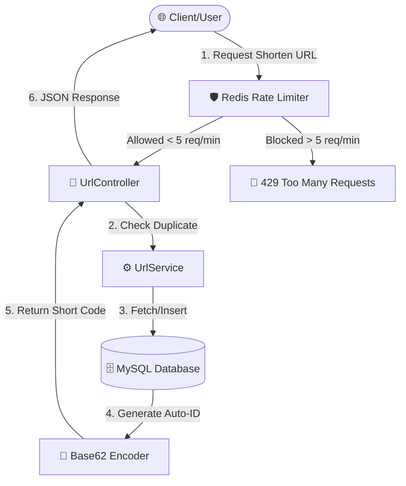
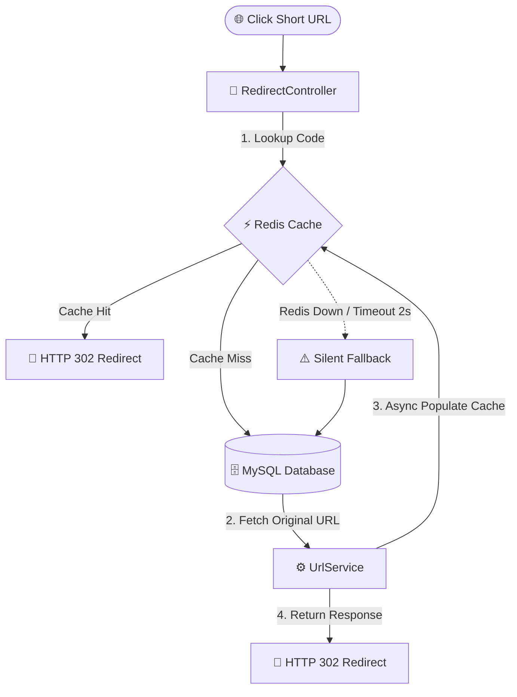

# 🔗 Scalable URL Shortener Service

A production-style, high-performance backend service that converts long URLs into short, shareable codes and redirects users safely. Engineered to demonstrate advanced production patterns: high-throughput caching, graceful degradation, and rate-limiting.

🚀 **Live Demo:** [View Live Deployment](https://railway.app)

---

## 🏗️ System Architecture & Workflow

The application follows a strict layered architecture optimized for low-latency lookups using a cache-aside pattern.

### 1. URL Creation & Rate Limiting Flow


### 2. High-Speed Redirect Flow (Cache-Aside Pattern)


---

## ⚡ Core Features

- **High-Performance Caching:** Implemented Redis caching using the **Cache-Aside pattern** with a 1-hour TTL for ultra-fast redirects.
- **Resilient Architecture (Graceful Degradation):** Configured strict Redis timeouts (2s connect/read) wrapped in try-catch blocks. If Redis goes down, the system silently falls back to MySQL without any downtime.
- **Security & Rate Limiting:** Implemented IP-based rate limiting (5 requests/minute per IP) backed by Redis on the creation endpoint.
- **Thread-Safe Short Code Generation:** Utilizes **Base62 encoding** on auto-incrementing database IDs to guarantee short, unique, and collision-free alphanumeric keys.
- **Centralized Error Handling:** Global exception handling layers returning clean JSON responses (e.g., 404 for unknown codes, 400 for invalid inputs).
- **SEO & Analytics Friendly:** Returns **HTTP 302 (Temporary Redirect)** instead of 301, ensuring every user click hits the server to track analytics accurately.

---

## 🛠️ Tech Stack

- **Language & Framework:** Java 21, Spring Boot 4
- **Database Layer:** Spring Data JPA + MySQL
- **Caching Layer:** Spring Data Redis (Lettuce client with custom timeouts)
- **Containerization:** Docker Compose (Multi-container setup for MySQL + Redis)
- **Testing Framework:** JUnit 5

---

## 📐 Detailed Design Decisions

* **Base62 Encoding over Random Strings:** Short codes are generated by encoding the database's auto-increment ID in base62 (`0-9`, `a-z`, `A-Z`). This keeps codes short and naturally guarantees no collisions since database IDs are already unique.
* **Why HTTP 302 over 301?** A 301 (permanent redirect) gets aggressively cached by modern browsers. Repeat clicks would never reach our server, making click analytics impossible to track. 302 ensures every click hits the application backend.
* **Redis Timeout Optimization:** Without explicit timeouts, a downed Redis instance causes the client connection to hang for several seconds per request before failing over. Setting a short 2-second timeout makes the fallback to MySQL instantaneous and unnoticeable to the user.

---

## 🚀 Running Locally

### Prerequisites
- Java 21
- Maven
- Docker Desktop

### Steps to Setup

1. **Clone the repository:**
   ```bash
   git clone https://github.com
   cd url-shortener
   ```
2. **Environment Configuration:**
   Copy `.env.example` to `.env` and fill in your environment variables.
3. **Start Infrastructure Services:**
   Launch the Redis and MySQL containers in the background:
   ```bash
   docker compose up -d
   ```
4. **Run the Application:**
   Ensure `DB_USER` and `DB_PASSWORD` are exported or set in your environment, then execute:
   ```bash
   mvn spring-boot:run
   ```
   *The application will start running locally on `http://localhost:8080`.*

---

## 🔌 API Endpoints

### 1. Create a Short URL
* **Endpoint:** `POST /api/urls`
* **Headers:** `Content-Type: application/json`
* **Request Body:**
  ```json
  { 
    "longUrl": "https://example.com" 
  }
  ```
* **Success Response (200 OK):**
  ```json
  { 
    "shortCode": "1", 
    "shortUrl": "http://localhost:8080/1" 
  }
  ```

### 2. URL Redirection
* **Endpoint:** `GET /{code}`
* **Behavior:** Returns an **HTTP 302 redirect** to the original long URL, or a `404 Not Found` JSON error response if the code does not exist.

---

## 🧪 Testing
The codebase includes comprehensive unit tests verifying Base62 encoding accuracy and concurrency safety under multi-threaded environments.
```bash
# Run the test suite
.\mvnw test
```

---

## 🔮 Future Roadmap
- [ ] **Asynchronous Click Analytics:** Introduce Kafka/RabbitMQ to log click metrics asynchronously to keep redirects sub-millisecond.
- [ ] **Interactive API Docs:** Integrate Swagger/OpenAPI UI for live API testing.
- [ ] **Load Testing:** Conduct high-concurrency benchmarks using **k6** to stress-test the Redis fallback latency.
